# DriveNow

**DriveNow Car Rental Management System** – a Blazor Web App (.NET 10) used by car-rental staff to manage cars, bookings and rental locations.

> Full Stack Development 1 – Final Project (CA3)

---

## Project Description

DriveNow is a web application for the staff of a small car rental company. After logging in, staff can:

- see live **dashboard statistics** for the fleet,
- **add, edit, delete, search and filter cars**,
- **create and cancel bookings**, with automatic conflict detection and car availability updates,
- **browse and search rental locations** (read-only).

The app uses three REST APIs:

| API | Base URL | Operations used |
|-----|----------|-----------------|
| Cars | `https://egolance.com/api/cars` | GET all, GET by id, POST, PUT, DELETE |
| Bookings | `https://egolance.com/api/bookings` | GET all, GET by id, POST, DELETE |
| Locations | `https://egolance.com/api/locations` | GET all, GET by id (read-only) |

It is built with Razor components, Bootstrap 5 and a service layer (`CarService`, `BookingService`, `LocationService`, `AuthService`). All API calls go through typed `HttpClient`s.

## Features

### Core
- **Authentication & authorization**: login, logout, protected pages, session management with a custom `AuthenticationStateProvider` (hardcoded users, encrypted browser session storage, 8-hour session timeout).
- **Dashboard**: Total Cars, Available Cars, Active Bookings and Total Locations, built from a reusable `DashboardCard` component. Also lists active and upcoming bookings and shows the fleet split by fuel type.
- **Cars**: list, add, edit and delete cars, search by registration/make/model, filter by availability and fuel type, sort columns, pagination.
- **Bookings**: list, create and delete bookings, with validation. Overlapping bookings are blocked: the form warns live, the service checks before saving, and an HTTP 409 from the API is handled. A vehicle availability panel shows which cars are booked and until when.
- **Locations**: card list with search, plus a details page with an embedded map. Read-only: no create, edit or delete.

### Business rules enforced
- Registration number required, unique, 5–20 characters. Make and Model required, max 50 characters. Year 1990–2035. Daily rate €1–€1000. Fuel type required, max 20 characters.
- A car with active or upcoming bookings cannot be deleted (checked before deleting, and an HTTP 409 from the API is handled).
- A car becomes **unavailable automatically** while it has an active booking, and becomes **available again** when its active bookings are cancelled.
- Booking customer name is required (max 100 characters), the car must exist, the start date cannot be in the past, the end date must be after the start date, and bookings cannot overlap (HTTP 409).

### Reusable components
`NavMenu`, `TopBar`, `SearchBox`, `ConfirmDeleteModal`, `AppModal`, `DashboardCard`, `AppAlert`, `LoadingSpinner`, `EmptyState`, `StatusBadge`, `PageHeader`, `Pagination`, `ToastContainer`, `CarForm`, `BookingForm`, `RedirectToLogin`.

### Validation, state and error handling
- `EditForm` + `DataAnnotationsValidator` + `ValidationMessage` on every form, plus custom `[NotInPast]` and `[DateGreaterThan]` attributes.
- `AppState` (shared scoped state): the active-booking badge in the nav menu, automatic dashboard refresh after changes, and Cars/Bookings filters that are remembered between pages.
- Friendly error messages, loading spinners, empty states and **Try again** buttons. The app keeps working when an API is down.

### Distinction features
- Booking cost calculator (days × daily rate)
- Advanced filtering, sorting and pagination
- Toast notifications
- Dark mode (remembered in localStorage)
- CSV export (cars and bookings) and a printable report (Print / Save as PDF)
- Reports page with estimated revenue per car
- Role-based navigation and authorization (Admin vs Staff)

## Demo Accounts

| Username | Password | Role | Access |
|----------|----------|------|--------|
| `admin` | `Admin123!` | Admin | Full access: add, edit and delete cars, manage bookings, view locations and the Reports page |
| `staff` | `Staff123!` | Staff | View, search and filter cars, create and delete bookings, view locations. Cannot add, edit or delete cars, and cannot open Reports |

## Setup Instructions

### Prerequisites
- [.NET 10 SDK](https://dotnet.microsoft.com/download/dotnet/10.0)
- Visual Studio 2026 (with the *ASP.NET and web development* workload), VS Code with C# Dev Kit, or the `dotnet` CLI

### Run with Visual Studio
1. Clone the repository: `git clone https://github.com/CaioMedeiros00/FullStackCA3.git`
2. Open `DriveNow.slnx`.
3. Choose the **https** launch profile and press **F5**.
4. Log in with one of the demo accounts above.

### Run with the .NET CLI
```bash
git clone https://github.com/CaioMedeiros00/FullStackCA3.git
cd FullStackCA3/DriveNow
dotnet run --launch-profile https
```
Then open https://localhost:7180.

### API configuration
The API base URL is set in `DriveNow/appsettings.json`:

```json
"ApiSettings": {
  "BaseUrl": "https://egolance.com/api/",
  "UseLocalApi": false,
  "LocalBaseUrl": "https://localhost:7180/api/",
  "TimeoutSeconds": 15
}
```

The project also contains an **optional local in-memory API** (`Api/LocalApiEndpoints.cs`) with the same routes and business rules. Set `"UseLocalApi": true` to use it, for example if egolance.com is offline. No database is needed.

## Screenshots

| | |
|---|---|
| **Login** 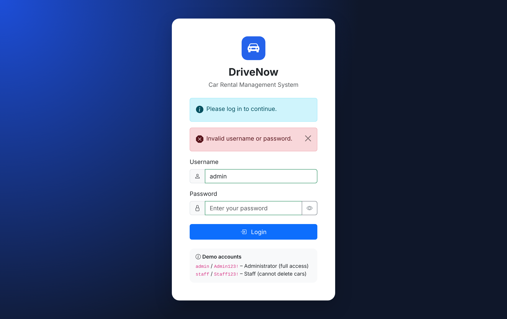 | **Dashboard** 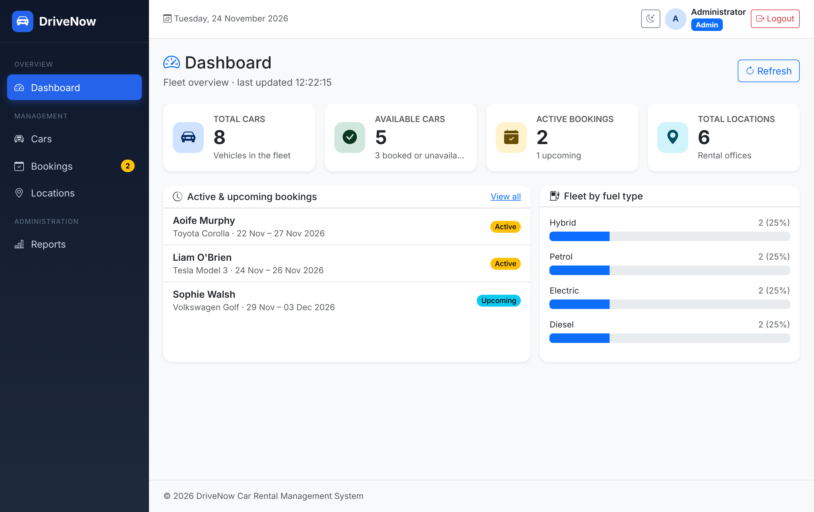 |
| **Cars** 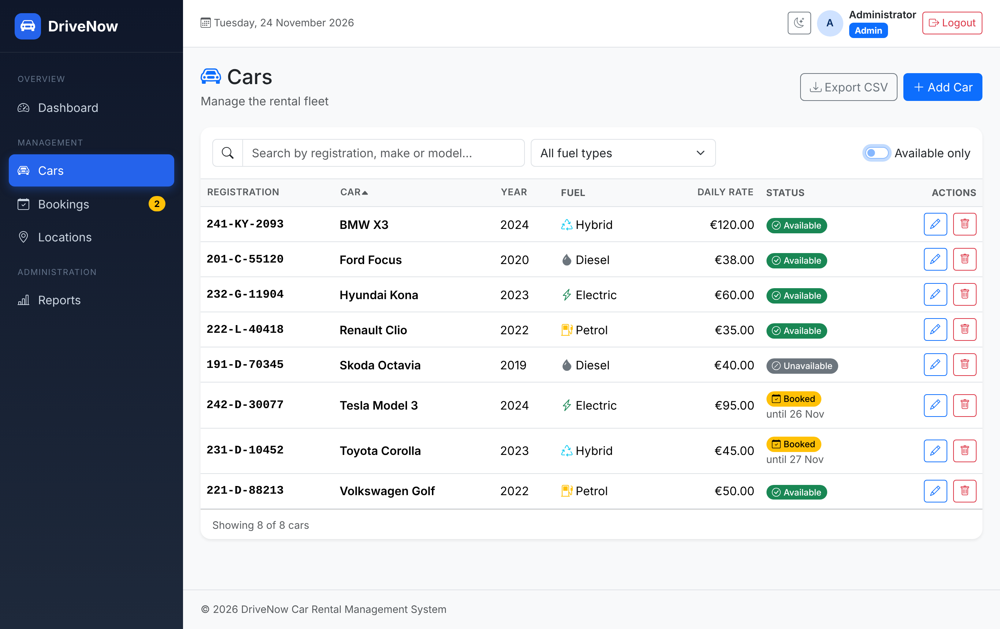 | **Car form validation** 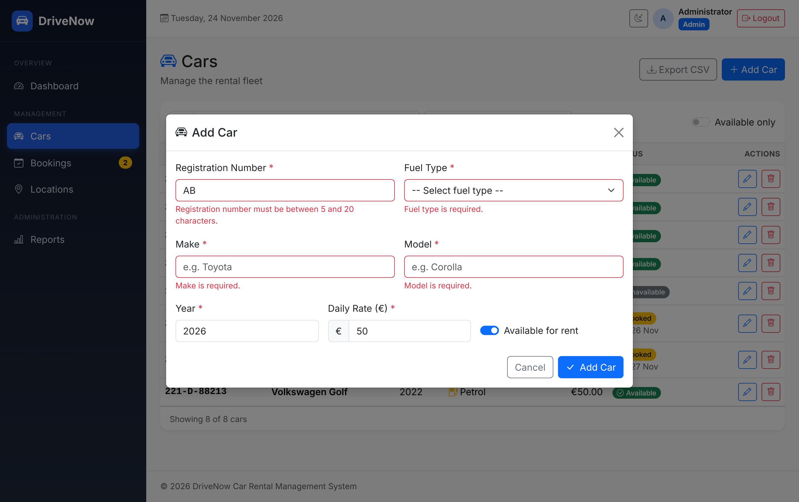 |
| **Delete confirmation** 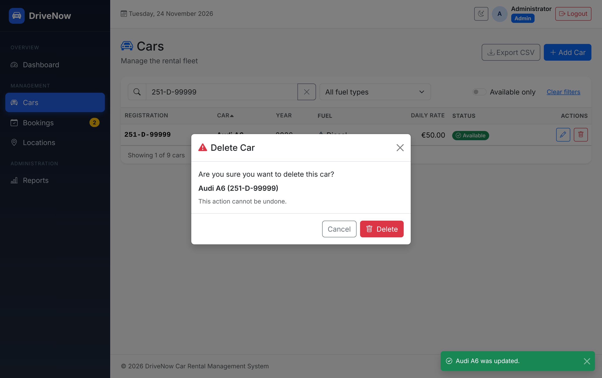 | **Bookings** 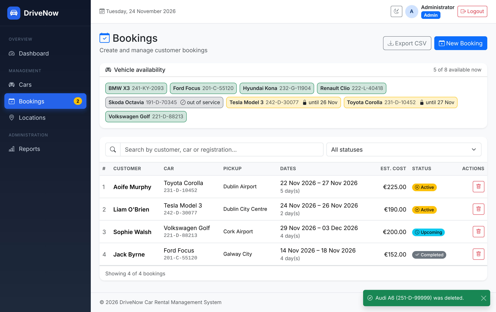 |
| **Booking conflict + cost calculator** 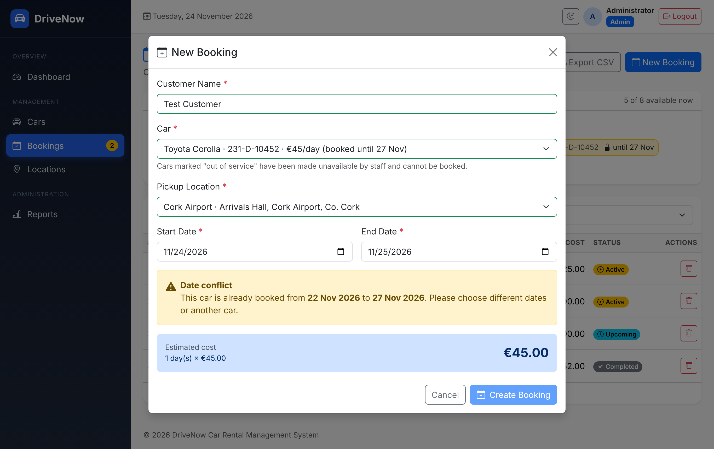 | **Locations** 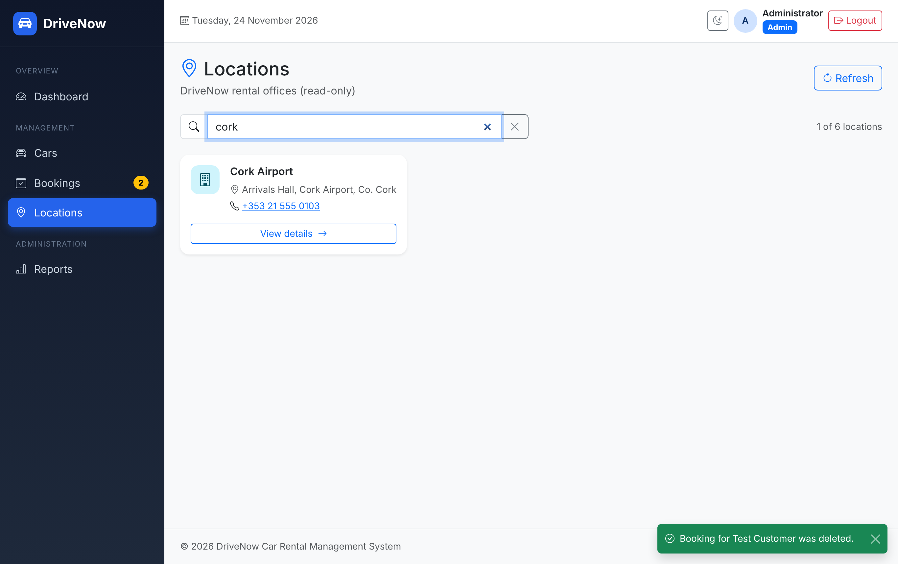 |
| **Location details** 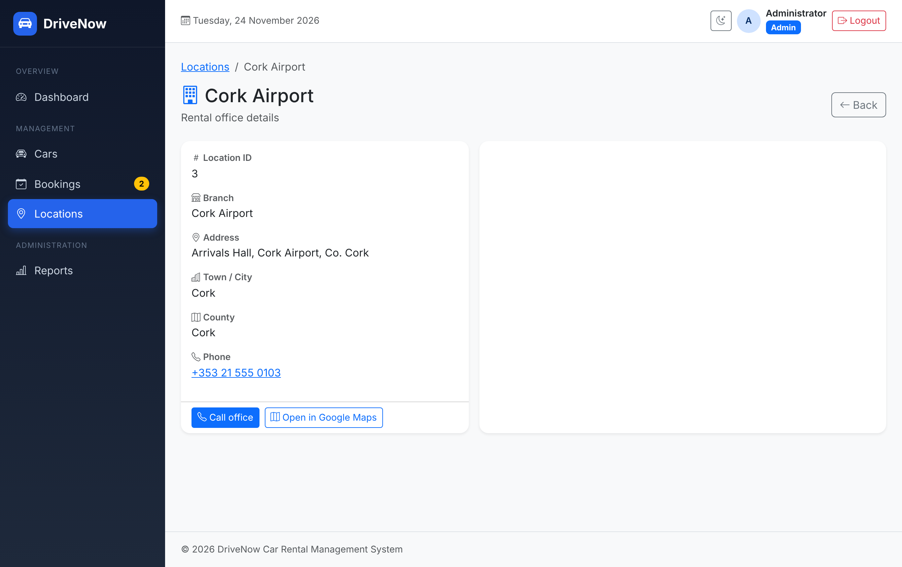 | **Reports (dark mode)** 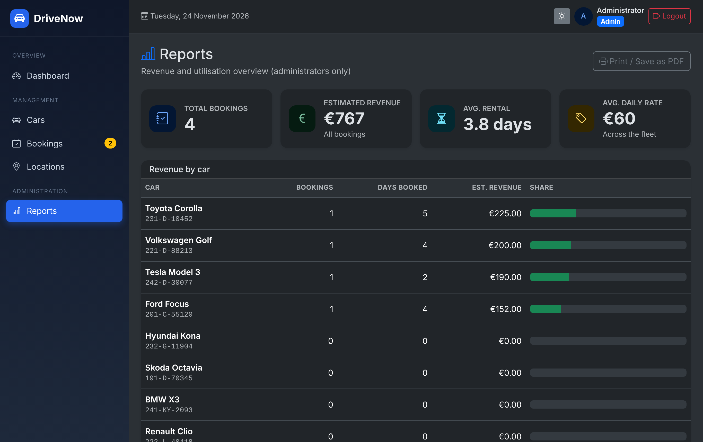 |
| **Dashboard (dark mode)** 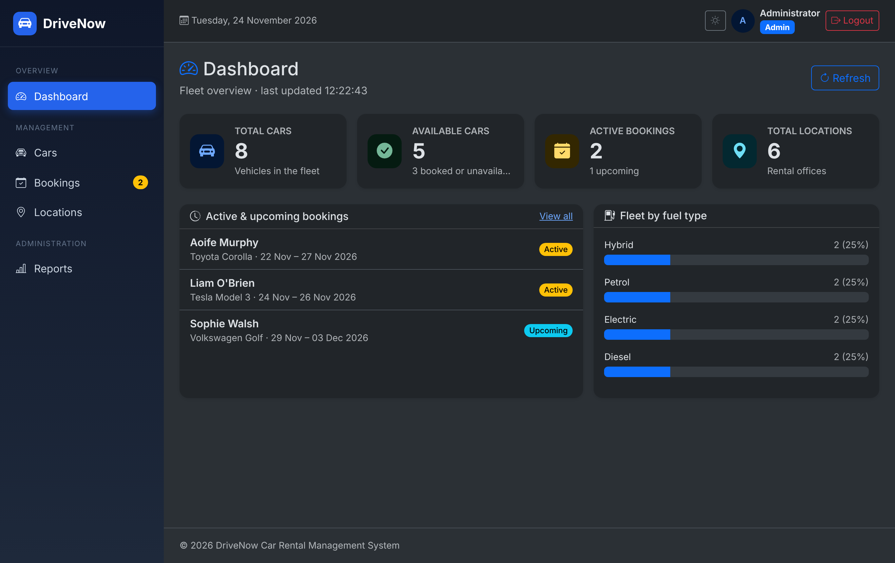 | **Mobile** 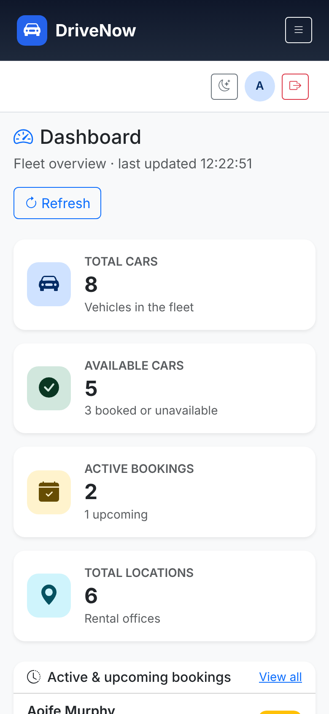 |

## Project Structure

```
DriveNow/
├── Api/                  Optional local REST API (Minimal APIs + in-memory store)
├── Auth/                 DriveNowAuthStateProvider (custom AuthenticationStateProvider)
├── Components/
│   ├── Layout/           MainLayout (protected), EmptyLayout, NavMenu, TopBar
│   ├── Pages/            Login, Home (Dashboard), Cars, Bookings, Locations, LocationDetails, Reports
│   └── Shared/           Reusable components (SearchBox, ConfirmDeleteModal, DashboardCard, AppAlert, ...)
├── Models/               Car, Booking, Location, ServiceResult, BookingRules, ...
├── Services/             ApiServiceBase, CarService, BookingService, LocationService, AuthService
├── State/                AppState, ToastService, ThemeService
├── Validation/           Custom validation attributes
├── wwwroot/              app.css, js/app.js, Bootstrap + Bootstrap Icons
└── Program.cs            Dependency injection and HTTP pipeline
```

## Notes on the live API
The live egolance.com API differs slightly from the brief, and DriveNow handles both formats:
- Bookings use `pickupDate`/`returnDate` and include a `locationId`. The `Booking` model maps these to `StartDate`/`EndDate` and sends both names.
- Locations return `branchName`/`city`/`county` instead of `name`/`address`/`phone`.
- `GET /api/locations/{id}` currently returns 404, so `LocationService` falls back to finding the location in the list.

## Author

- **Name:** Caio Medeiros
- **Student number:** 77281
- **Course / Module:** Full Stack Development 1 - Dorset College Dublin
- **GitHub:** [CaioMedeiros00](https://github.com/CaioMedeiros00)
